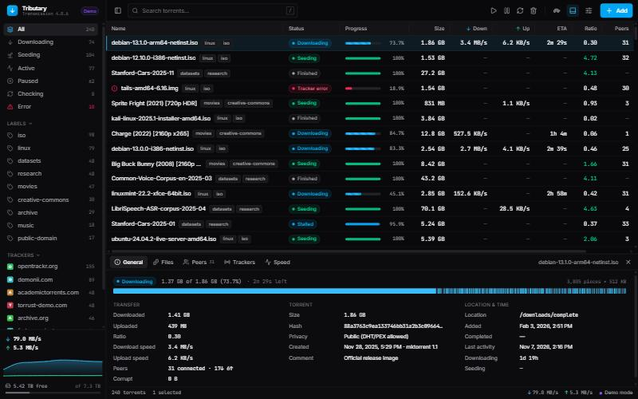

<div align="center">

# Tributary

**Eine schnelle, moderne Weboberfläche für den BitTorrent-Client [Transmission](https://transmissionbt.com).**

[English](../README.md) · [简体中文](README.zh-CN.md) · [Español](README.es.md) · [Français](README.fr.md) · **Deutsch** · [日本語](README.ja.md)



</div>

---

## Was ist das?

[Transmission](https://transmissionbt.com) ist ein beliebtes, kostenloses BitTorrent-Programm. Oft läuft es unauffällig im
Hintergrund (als „Daemon“) auf einem Heimserver, NAS oder Raspberry Pi und wird über den Browser bedient.

**Tributary** ist eine Webseite, die die eingebaute Weboberfläche von Transmission ersetzt. Sie fühlt sich an wie eine
Desktop-App, gibt es in 6 Sprachen und bleibt auch bei Tausenden von Torrents flott. Sie spricht direkt mit Transmission, du
musst also keinen zusätzlichen Server und keine Datenbank einrichten.

> Tributary ist ein unabhängiges Projekt und steht in keiner Verbindung zum Transmission-Team.

## Funktionen

- 📋 **Torrent-Liste**: sortieren, Spalten anpassen und ausblenden, Mehrfachauswahl (Umschalt / Strg), Rechtsklick-Menü, flüssig auch mit über 5.000 Torrents
- 🔍 **Filter und Suche**: nach Status (lädt herunter, verteilt, Fehler …), nach Label, nach Tracker
- 🔬 **Detailbereich**: allgemeine Infos mit Teile-Karte, Dateibaum (wähle, was heruntergeladen wird), Peers, Tracker, Geschwindigkeitsgraph
- ➕ **Torrents einfach hinzufügen**: `.torrent`-Datei irgendwo auf die Seite ziehen oder Magnet-Links einfügen
- 🐢 **Schildkrötenmodus** und vollständige **Einstellungen** (Geschwindigkeitslimits, Warteschlange, Seed-Regeln, Netzwerk)
- 🌍 **6 Sprachen**: English, 简体中文, Español, Français, Deutsch, 日本語, automatisch passend zu deinem Browser
- 🌙 **Dunkles und helles Design**, Tastenkürzel (drücke <kbd>?</kbd> in der App)
- 🎮 **Demomodus**: alles mit simulierten Torrents ausprobieren, ganz ohne Transmission

---

## Schnellstart: Demo ausprobieren (5 Minuten)

Dafür brauchst du kein Transmission. Tributary merkt, dass kein Transmission da ist, und wechselt in den **Demomodus** mit Beispiel-Torrents.

### 1. Node.js installieren

Lade die **LTS**-Version von [nodejs.org](https://nodejs.org) herunter und installiere sie (Version 20 oder neuer).
Zum Prüfen öffne ein Terminal (Windows: *PowerShell*, macOS: *Terminal*) und führe aus:

```bash
node --version
```

### 2. Code herunterladen

Klicke auf dieser Seite auf den grünen Button **Code → Download ZIP** und entpacke die Datei, oder, falls du Git hast:

```bash
git clone https://github.com/manb0fish/tributary.git
cd tributary
```

### 3. Installieren und starten

In einem Terminal im Ordner `tributary`:

```bash
npm install
npm run dev
```

Öffne jetzt **http://localhost:5173** im Browser. Oben links erscheint ein lila **Demo**-Abzeichen. 🎉

Zum Beenden drücke im Terminal <kbd>Strg</kbd> + <kbd>C</kbd>.

---

## Mit deinem eigenen Transmission verbinden

### 1. Sicherstellen, dass Transmission Fernzugriff erlaubt

- **Transmission-Desktop-App:** Öffne *Einstellungen → Fernsteuerung* und aktiviere **Fernzugriff erlauben**. Der Standardport ist **9091**.
- **transmission-daemon** (Server / NAS): Fernzugriff ist standardmäßig aktiv. Wenn du Benutzername und Passwort festgelegt
  hast, fragt dein Browser danach.

### 2. Tributary darauf zeigen lassen

Ersetze die Adresse durch die des Rechners, auf dem Transmission läuft (`http://localhost:9091`, wenn es derselbe Computer ist).

**macOS / Linux:**

```bash
TRANSMISSION_URL=http://192.168.1.10:9091 npm run dev
```

**Windows (PowerShell):**

```powershell
$env:TRANSMISSION_URL="http://192.168.1.10:9091"; npm run dev
```

Öffne **http://localhost:5173**. Die Statusleiste unten rechts sollte **Verbunden** anzeigen (grüner Punkt).

---

## Dauerhaft installieren

Mit den Schritten oben läuft Tributary auf deinem Computer. Damit **Transmission selbst** Tributary ausliefert (und du es von
jedem Gerät aus öffnen kannst, ohne dass sonst etwas laufen muss), baust du es einmal und verweist Transmission auf das Ergebnis.

### 1. Dateien besorgen

**Am einfachsten: herunterladen (kein Node.js nötig).** Öffne das [neueste Release](https://github.com/manb0fish/tributary/releases/latest), lade **tributary.zip** (oder
**tributary.tar.gz**) herunter und entpacke es. Du erhältst einen Ordner namens `tributary`. Kopiere ihn auf den Rechner,
auf dem Transmission läuft, zum Beispiel nach `/opt/tributary`.

Auf einem Linux-Server geht das auch direkt im Terminal:

```bash
cd /opt
sudo curl -L -o tributary.tar.gz https://github.com/manb0fish/tributary/releases/latest/download/tributary.tar.gz
sudo tar -xzf tributary.tar.gz
```

**Oder selbst bauen:** Führe im Projektordner `npm run build` aus. Das Ergebnis liegt in `dist/`; verwende stattdessen diesen Ordner.

### 2. Transmission anweisen, ihn zu verwenden

Transmission liest beim Start die Umgebungsvariable `TRANSMISSION_WEB_HOME`.

**Linux mit systemd** (die meisten Server):

```bash
sudo systemctl edit transmission-daemon
```

Füge diese Zeilen ein, speichere und starte neu:

```ini
[Service]
Environment=TRANSMISSION_WEB_HOME=/opt/tributary
```

```bash
sudo systemctl restart transmission-daemon
```

**Docker:** Binde den Ordner `tributary` in den Container ein (zum Beispiel unter `/tributary`) und setze die Umgebungsvariable
`TRANSMISSION_WEB_HOME=/tributary`.

**Alles andere:** Setze `TRANSMISSION_WEB_HOME` auf den vollständigen Pfad des Ordners, bevor du Transmission startest.

### 3. Öffnen

Rufe **http://DEIN-SERVER:9091/transmission/web/** auf. Fertig!

---

## Tipps

| Was du willst | So geht’s |
| --- | --- |
| Torrent hinzufügen | `.torrent`-Datei auf die Seite ziehen oder **+ Hinzufügen** klicken |
| Mehrere Torrents auswählen | <kbd>Umschalt</kbd>+Klick für einen Bereich, <kbd>Strg</kbd>/<kbd>⌘</kbd>+Klick für einzelne |
| Weitere Aktionen | Rechtsklick auf einen Torrent |
| Dateien zum Herunterladen wählen | Torrent auswählen → Reiter **Dateien** → Dateien abwählen |
| Suchen | <kbd>/</kbd> drücken und tippen |
| Sprache oder Design ändern | ⚙ (Schieberegler-Symbol oben rechts) → **Sprache** / **Design** |
| Alle Tastenkürzel ansehen | <kbd>?</kbd> drücken |

Nützliche URL-Optionen: `?demo` erzwingt den Demomodus, `?mock=5000` erzeugt eine Demo mit 5.000 Torrents.

## Fehlerbehebung

<details>
<summary><b>„Transmission ist nicht erreichbar“</b></summary>

- Prüfe Adresse und Port (Standard **9091**) und ob Transmission läuft.
- Öffne testweise direkt `http://ADRESSE:9091/transmission/web/`. Lädt auch das nicht, liegt das Problem zwischen deinem
  Computer und Transmission (Firewall, falsche IP).
- Bei **403 Forbidden** blockiert die `rpc-whitelist` von Transmission deinen Computer. Beende Transmission, trage in
  `settings.json` deine IP in `rpc-whitelist` ein (oder setze in einem vertrauenswürdigen Heimnetz `rpc-whitelist-enabled`
  auf `false`) und starte es wieder. Transmission überschreibt `settings.json` beim Beenden, also *vorher* beenden.
</details>

<details>
<summary><b>Es werden immer Demodaten angezeigt</b></summary>

Tributary wechselt in den Demomodus, wenn keine Verbindung möglich ist. Öffne ⚙ → **Verbindung** und wähle
**Nur echter Daemon**, um den eigentlichen Fehler zu sehen. Dann hilft der Abschnitt oben weiter.
</details>

<details>
<summary><b>„Port 5173 is already in use“ (Port belegt)</b></summary>

Ein anderes Programm nutzt diesen Port. Beende es oder starte mit `npm run dev -- --port 5174`.
</details>

---

## Sprachen

Tributary übernimmt automatisch die Sprache deines Browsers. Du kannst sie jederzeit über ⚙ → **Sprache** oder
*Einstellungen → Oberfläche* ändern.

**Du möchtest eine Sprache hinzufügen?** Kopiere `src/i18n/locales/en.ts` in eine neue Datei (z. B. `it.ts`), übersetze die
Texte und füge sie der Liste `LOCALES` in `src/i18n/index.ts` hinzu. Fehlt ein Schlüssel, sagt dir `npm run typecheck`
genau welcher. Pull Requests sind willkommen!

## Für Entwickler

| Befehl | Funktion |
| --- | --- |
| `npm run dev` | Startet den Entwicklungsserver mit Hot Reload |
| `npm run build` | Prüft die Typen und baut nach `dist/` |
| `npm run typecheck` | Prüft nur die Typen |
| `npm run preview` | Liefert das gebaute `dist/` lokal aus |

**Gebaut mit:** React 19, TypeScript (strikt), Vite, Tailwind CSS 4, Radix UI, TanStack Query / Table / Virtual, Zustand.

```
src/
├── lib/rpc/        Transmission-RPC-Client (erledigt den 409-Session-ID-Handshake), Typen, Demo-Backend
├── lib/            Torrent-Cache mit inkrementellem Polling, Formatierung, Status-Helfer
├── i18n/           Übersetzungssystem + eine Datei pro Sprache
├── components/     Seitenleiste, Werkzeugleiste, Tabelle, Detailbereich, Dialoge
├── hooks/          Datenabruf (TanStack Query), Aktionen, Tastenkürzel
└── store/          UI-Zustand (Zustand)
```

## Mitwirkende

- [@manb0fish](https://github.com/manb0fish): Projektinhaber
- **Claude** (KI-Assistent von [Anthropic](https://www.anthropic.com)): hat Code, Übersetzungen und Dokumentation mitgeschrieben

Neue Mitwirkende sind herzlich willkommen! Eine Übersetzung hinzuzufügen ist ein guter Einstieg (siehe [Sprachen](#sprachen)).

## Lizenz

[GPL-3.0](../LICENSE)
